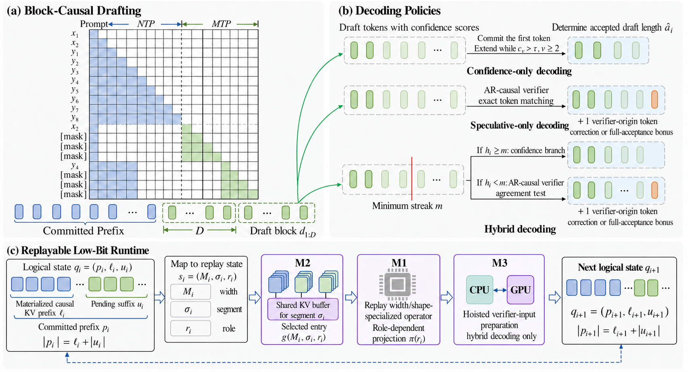

<div align="center">

# BitMTP

**When Multi-Token Prediction Meets Low-Bit Large Language Models**

Ning Zhang · Shihao Wang · Jinrui Zhang · Chaodong Xiao · Lei Zhang<br>
The Hong Kong Polytechnic University

**[NeurIPS 2026](https://neurips.cc/virtual/2026/loc/sydney/poster/154757)** · [Paper](https://arxiv.org/abs/2610.28500) · [Models](#models) · [Quick start](#quick-start)

</div>

**BitMTP makes low-bit LLMs faster: 2×+ decoding speedups with multi-token prediction across server, consumer, and edge GPUs.**

## 📝 Content

- [News](#news)
- [Overview](#overview)
- [Models](#models)
- [Quick start](#quick-start)
- [Documentation](#documentation)
- [Repository layout](#repository-layout)
- [Acknowledgements and licenses](#acknowledgements-and-licenses)

<a id="news"></a>

## 🔥 News

- **2026.10** 🎉 We release the [BitMTP code](https://github.com/PolyU-VCLab/BitMTP) and [Bonsai checkpoints](#models).
- **2026.09** 🎉 BitMTP has been accepted to [**NeurIPS 2026**](https://neurips.cc/virtual/2026/loc/sydney/poster/154757)!

<a id="overview"></a>

## ✨ Overview

BitMTP couples multi-token prediction with ternary model execution. Its CUDA runtime uses width-specialized kernels and shared-KV graph replay for multi-token decoding. This repository provides Bonsai training, model conversion, and low-bit inference for H20, RTX 3090, and Jetson Orin NX.



<a id="models"></a>

## 🤗 Models

This repository provides the Bonsai implementation with packed T2-g128 execution. Model checkpoints and their matching tokenizers are hosted on Hugging Face.

| Model | Weights | Documented platforms |
| --- | --- | --- |
| Bonsai-1.7B SFT | [SFT AR](https://huggingface.co/VCLab-PolyU/BitMTP-Bonsai-1.7B-SFT) | H20, RTX 3090, Orin NX |
| Bonsai-1.7B MTP | [D4](https://huggingface.co/VCLab-PolyU/BitMTP-Bonsai-1.7B-D4) | H20, RTX 3090, Orin NX |
| Bonsai-1.7B MTP | [D8](https://huggingface.co/VCLab-PolyU/BitMTP-Bonsai-1.7B-D8) | H20, RTX 3090, Orin NX |
| Bonsai-4B SFT | [SFT AR](https://huggingface.co/VCLab-PolyU/BitMTP-Bonsai-4B-SFT) | H20 |
| Bonsai-4B MTP | [D8](https://huggingface.co/VCLab-PolyU/BitMTP-Bonsai-4B-D8) | H20 |

H20 and RTX 3090 evaluation profiles cover GSM8K and HumanEval+. The [Jetson Orin guide](docs/orin.md) provides native-T2 single-prompt generation.

Convert the QAT checkpoints with BitMTP before low-bit inference.

<a id="quick-start"></a>

## 🚀 Quick start

### Install

Clone the repository:

```bash
git clone https://github.com/PolyU-VCLab/BitMTP.git
cd BitMTP
```

Use Python 3.10 and a CUDA development toolkit with `nvcc`. The following environment is for H20; for other GPUs, follow the [RTX 3090](docs/rtx3090.md) or [Jetson Orin](docs/orin.md) guide instead.

```bash
python -m venv .venv
source .venv/bin/activate
python -m pip install -r requirements/h20.txt
python -m pip install --no-deps -e .
python -m pip check
SM_ARCH=90 NVCC=/usr/local/cuda/bin/nvcc bash src/bonsai_sft/gpu/t2g128_kernels/compile.sh
```

See [installation](docs/installation.md) for dependencies and [RTX 3090](docs/rtx3090.md) for its separate environment and BF16 draft path.

### Download, convert, and generate

Download Bonsai-1.7B D8, convert it, and run hybrid decoding on H20:

```bash
python -m bonsai_sft.download_model \
  --model bonsai_1p7_d8 --output weights/BitMTP-Bonsai-1.7B-D8

python -m bonsai_sft.gpu.convert_bonsai_mtp_to_gpu \
  --src weights/BitMTP-Bonsai-1.7B-D8 \
  --out weights/BitMTP-Bonsai-1.7B-D8-packed --quant ternary

python -m bonsai_sft.gpu.run_generation \
  --ckpt weights/BitMTP-Bonsai-1.7B-D8-packed \
  --hf-ckpt weights/BitMTP-Bonsai-1.7B-D8 \
  --block-size 8 --mode hybrid --threshold 0.9 --min-chain 6 \
  --draft-precision fp8 --verify-precision native \
  --chat --prompt 'Write a short greeting.' --max-new-tokens 128
```

For Bonsai-1.7B D4, use D4 weights, `--block-size 4`, and `--min-chain 3`. See [generation](docs/usage.md) for all decoding modes.

<a id="training-and-evaluation"></a>
<a id="documentation"></a>

## 📖 Documentation

| Task | Guide |
| --- | --- |
| Train SFT/MTP models on your JSONL data | [Training](docs/training.md) |
| Evaluate on GSM8K and HumanEval+ | [Evaluation](docs/evaluation.md) |
| Run software regression tests | [Tests](docs/testing.md) |

Training examples are in `configs/training/`, and evaluation profiles are in `configs/evaluation/`.

## Repository layout

```text
src/bonsai_sft/      Training, model export, and CUDA decoding
configs/             Training and evaluation settings
benchmarks/          GSM8K and HumanEval+ evaluation
scripts/             Training launcher
tests/               Software regression tests
docs/                Installation, usage guides, and method overview
requirements/        Platform and CPU-scoring dependencies
docker/              Isolated HumanEval+ CPU scorer
licenses/            Third-party license texts
```

## Acknowledgements and licenses

BitMTP code is licensed under [Apache-2.0](LICENSE). Third-party components retain their respective copyrights and licenses; see [THIRD_PARTY_NOTICES.md](THIRD_PARTY_NOTICES.md). Model weights and datasets retain their respective terms.

We thank the [Bonsai](https://github.com/PrismML-Eng/Bonsai-demo), [SDLM](https://github.com/OpenGVLab/SDLM), and [BitNet / bitnet.cpp](https://github.com/microsoft/BitNet) teams and contributors, and the broader open-source community advancing low-bit language models and efficient inference.
